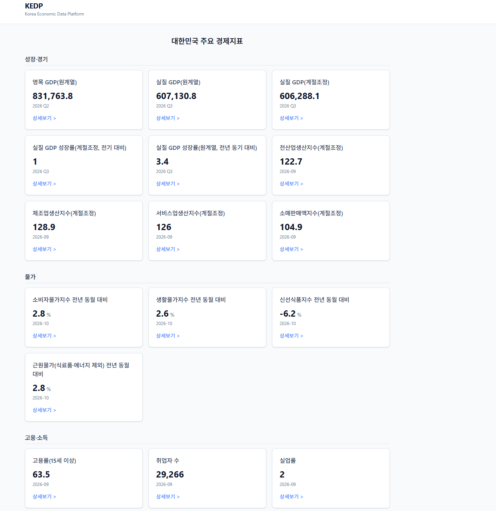
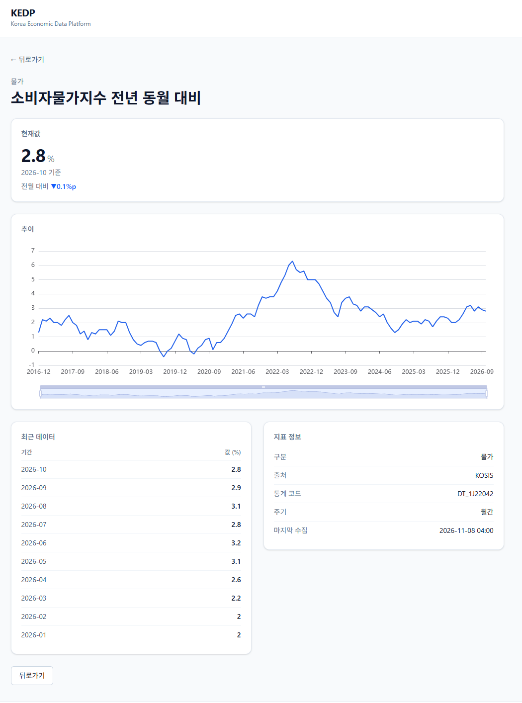
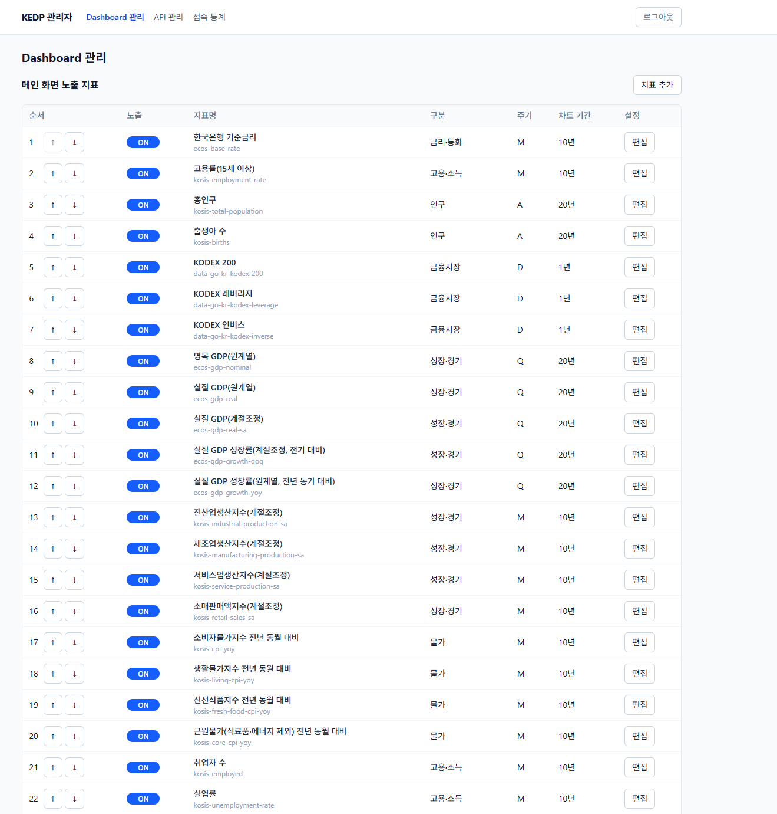
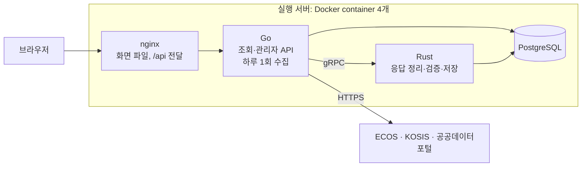

# KEDP: 한국 경제 데이터 플랫폼

[](https://github.com/schware/aidev-KEDP001/actions/workflows/test.yml) [](https://github.com/schware/aidev-KEDP001/actions/workflows/secret-scan.yml)

한국은행 ECOS, 통계청 KOSIS, 공공데이터포털이 무료로 제공하는 공식 통계를 하루 한 번 모아, 한 화면에서 주요 경제지표를 보여 주는 웹 서비스다.



## 지금 상태

- **MVP 완료** (2026-11-01). 실행 서버에서 Docker로 운영 중이다.
- **지표 42개**, 구분 9개(성장·경기, 물가, 고용·소득, 금리·통화, 부채·금융안정, 대외경제, 주택, 인구, 금융시장)
- **제공처 3곳**: ECOS, KOSIS, 공공데이터포털(금융위원회_증권상품시세정보)
- **하루 1회 자동 수집**(시각은 관리자 화면에서 정한다). 공식기관이 고친 값은 이전 값을 이력으로 남긴다.

## 기능

**사용자**

- 메인 화면: 구분별 지표 카드(최신값, 기준 시점)
- 상세 화면: 추이 차트, 최근 데이터, 출처·통계 코드·주기·마지막 수집 시각, 관련 지표

| 상세 화면 | 관리자 Dashboard |
| --- | --- |
|  |  |

**관리자** (지정 주소 + 허용 IP + 계정, KEDP001-D018)

- Dashboard 관리: 지표 추가, 노출 켜고 끄기, 순서, 구분, 차트 기간, 관련 지표, 표시 형식
- API 관리: 수집 시각, 제공처별 연결 상태와 마지막 수집. API 키는 화면에서 다루지 않는다
- 접속 통계: 하루 방문자 수. IP는 저장하지 않는다

## 구조



- 바깥에 열린 문은 nginx 하나다. Go, Rust, PostgreSQL은 Docker 내부 network에서만 접속한다.
- API 키는 Go만 가진다. image에는 키를 넣지 않고 실행할 때 `.env`에서 넣는다.
- 개발할 때는 Vite 개발 서버가 nginx 자리에서 같은 일을 한다. 자세한 흐름은 [docs/call-flow.md](docs/call-flow.md)에 있다.

| 영역 | 기술 | 폴더 |
| --- | --- | --- |
| 화면 | TypeScript, React, Vite, Tailwind CSS, Apache ECharts | `f-ts-end/` |
| 수집·API | Go | `b-go-end/` |
| 응답 처리 | Rust, tonic(gRPC) | `b-rust-processor/` |
| Go–Rust 약속 | Protocol Buffers | `b-proto/` |
| 저장 | PostgreSQL 17 | `b-sql-db/` |
| 배포 | Docker, compose, nginx, GitHub Actions, GHCR | `deploy/`, `.github/workflows/` |

## 왜 이렇게 만들었나

결정은 모두 [records/07.decision/decisions/](records/07.decision/decisions/)에 배경, 대안, 이유와 함께 남겼다. 핵심 결정은 다음과 같다.

- **Go와 Rust를 gRPC로 나눴다** ([D002](records/07.decision/decisions/KEDP001-D002.md)): 외부 API 호출과 웹 API는 Go가 맡는다. 제공처마다 다른 응답을 정리하고 검증하는 일은 Rust가 맡는다. 두 서버는 `b-proto/`의 약속서로만 이야기한다.
- **실제 API 응답을 확인한 뒤 DB를 설계했다** ([D004](records/07.decision/decisions/KEDP001-D004.md), [D022](records/07.decision/decisions/KEDP001-D022.md)): ECOS, KOSIS, 공공데이터포털의 실제 응답을 [samples/](samples/)에 먼저 모았다. 그 응답을 보고 key, 단위, 기간 형식을 정했다. 확인하지 않은 지표 코드는 쓰지 않는다.
- **API 키를 5겹으로 보호한다** ([D012](records/07.decision/decisions/KEDP001-D012.md)): `.env`를 git에서 뺀다. 코드는 기록을 남길 때 키를 `***`로 가린다. commit 전 hook이 실제 키 값과 gitleaks로 검사한다. PR마다 gitleaks로 commit 기록 전체를 검사한다. 화면에서는 키를 다루지 않는다(D018).
- **MVP는 조회만 한다** ([D017](records/07.decision/decisions/KEDP001-D017.md)): 수집 → 저장 → 조회를 먼저 끝냈다. 지표 비교와 분석은 2차로 미뤘다.
- **배포는 단순하게 시작했다** ([D020](records/07.decision/decisions/KEDP001-D020.md), [D023](records/07.decision/decisions/KEDP001-D023.md)): image는 개발 서버에서 만들어 SSH로 실행 서버에 옮긴다. 백업은 스크립트와 crontab으로 한다.
- **배포를 세 가지로 나누고 PR 중심으로 묶었다** ([D025](records/07.decision/decisions/KEDP001-D025.md)): 아래 "배포" 장을 본다.

## 개발 방식: AI Agent와 함께

이 프로젝트는 AI Agent(Claude Code)와 함께 만들었다. 사람은 결정하고, Agent는 초안을 쓰고 구현한다.

- **역할을 나눈다** ([D005](records/07.decision/decisions/KEDP001-D005.md)): Common(설계 정리), TypeScript, Go, Rust, Database. Agent는 한 번에 한 역할로 일하고 담당 폴더만 고친다.
- **규칙은 파일로 둔다** ([D009](records/07.decision/decisions/KEDP001-D009.md)): [.claude/CLAUDE.md](.claude/CLAUDE.md)에 문서 위치, 역할, git 규칙이 있다. 같은 질문을 다시 하지 않도록 정한 것은 결정 기록에 남긴다.
- **작업은 Issue 단위다** ([D014](records/07.decision/decisions/KEDP001-D014.md)): Issue마다 "고쳐도 되는 곳, 정해진 것, 끝났다는 기준, 하지 말 것"을 적는다. Agent는 branch에서 일하고, merge는 소유자가 한다.
- **결정은 소유자가 한다**: Agent는 결정 문서를 `proposed`로 쓰고, 소유자가 `decided`로 바꾼다.
- **비밀은 Agent에게도 보이지 않는다**: 키와 비밀번호는 서버의 `.env`에만 있다. 대화, 문서, 저장소에는 쓰지 않는다.

여러 프로젝트가 함께 쓰는 규칙은 [AI-Native-Development-Rules](https://github.com/schware/AI-Native-Development-Rules)에 있다.

만든 과정과 어려웠던 점은 [사례 문서](docs/case-study.md)에, 한 장 요약은 [docs/one-page.md](docs/one-page.md)에 있다.

## 배포

배포는 세 가지 방식으로 나누어 운영한다. 어느 방식이든 **PR 검사를 통과해 main에 merge된 commit만 배포**한다. main은 보호 설정(ruleset)으로 PR과 검사 통과 없이는 바뀌지 않는다.

| | A | B | C |
| --- | --- | --- | --- |
| image 만드는 곳 | 개발 서버 | GitHub Actions(`build-ghcr`) | GitHub Actions(`build-artifact`) |
| image 두는 곳 | 개발 서버 | GHCR(공개) | GitHub artifact |
| 보관 | 서버에 남은 image | 최근 5개 버전 | 14일 |
| 쓰임 | 평소 배포 | 최근 버전 안에서 되돌리기 | QA까지 확정한 배포, 14일 안에 확정 |

- tag는 build한 main commit의 짧은 hash다. 같은 commit이면 A, B, C 어느 방식으로 만들어도 tag가 같다.
- image에는 키와 비밀번호가 없다. 실행할 때 실행 서버의 `.env`에서 넣는다.
- 공개 저장소와 공개 package의 무료 범위 안에서 쓴다.

흐름, 명령, 처음 한 번 하는 GitHub 설정은 [docs/deploy-methods.md](docs/deploy-methods.md)에 있다.

## 실행 방법

명령 하나로 바로 뜨지는 않는다. 제공처 키와 DB 준비가 필요하다.

1. **API 키 발급** (무료, 가입 필요): ECOS(한국은행), KOSIS(통계청), 공공데이터포털(금융위원회_증권상품시세정보 활용 신청)
2. **`.env` 만들기**: [deploy/.env.example](deploy/.env.example)의 이름에 키, DB 비밀번호, 포트, 내부 network 대역을 넣는다.
3. **image 만들기**: `deploy/build.sh`가 go, rust, nginx image를 하나씩 만든다(Docker 23 이상).
4. **DB 준비**: `docker compose up -d postgres`로 PostgreSQL을 띄운다. 그다음 [b-sql-db/migrations/](b-sql-db/migrations/)를 0001부터 번호 순서로 적용한다.
5. **관리자 계정 파일**: `b-go-end/cmd/adminpass`로 계정과 비밀번호 hash 한 줄을 만든다.
6. **띄우기**: `docker compose up -d`로 container 4개를 띄우고 `http://<서버>:<포트>/`로 접속한다.

자세한 내용은 아래 문서에 있다.

- image 만들기와 보내기: [docs/docker-build.md](docs/docker-build.md)
- 처음 배포, 백업, 새 버전 올리기, 되돌리기: [docs/docker-deploy.md](docs/docker-deploy.md)
- 개발 환경에서 Go 서버 실행: [b-go-end/README.md](b-go-end/README.md)
- 키 보호 설정(clone 직후): [docs/key-protection.md](docs/key-protection.md)

## 저장소 구조

```text
aidev-kedp001/
├── README.md
├── project.yaml          프로젝트 기본 정보
├── .claude/              AI Agent 규칙 (CLAUDE.md, api.md, git.md, environment.md)
├── .github/              PR 검사(test, secret-scan), 배포 build(build-ghcr, build-artifact)
├── specification/        명세 (공통, 지표, DB, API, 화면)
├── records/              결정 기록 (D001~D025)
├── samples/              실제 API 응답 샘플
├── docs/                 안내서
├── b-go-end/             Go: 수집, REST API
├── b-proto/              Go–Rust 약속서 (소유자 승인 후 변경)
├── b-rust-processor/     Rust: 응답 정리·검증·저장 gRPC 서버
├── b-sql-db/             PostgreSQL: migration
├── f-ts-end/             TypeScript: 사용자·관리자 화면
└── deploy/               Docker compose, nginx 설정, build·send·backup 스크립트
```

## 문서 안내

| 무엇 | 어디 |
| --- | --- |
| 프로젝트 기본 정보 | [project.yaml](project.yaml) |
| AI Agent 규칙 | [.claude/CLAUDE.md](.claude/CLAUDE.md) |
| 공통 규칙 | [specification/00.common/README.md](specification/00.common/README.md) |
| 지표와 API 조사 결과 | [specification/10.indicators/README.md](specification/10.indicators/README.md) |
| DB 설계 | [specification/30.database/README.md](specification/30.database/README.md) |
| API | [specification/40.api/README.md](specification/40.api/README.md) |
| 화면 | [specification/50.web/README.md](specification/50.web/README.md) |
| 호출 흐름 | [docs/call-flow.md](docs/call-flow.md) |
| 배포 방식 A, B, C | [docs/deploy-methods.md](docs/deploy-methods.md) |
| Docker image와 배포 | [docs/docker-build.md](docs/docker-build.md), [docs/docker-deploy.md](docs/docker-deploy.md) |
| 결정 기록 | [records/07.decision/decisions/](records/07.decision/decisions/) |
| 작업 목록 | GitHub Issues |

`docs/AGENTS.md`, `docs/TODO.md`는 v0.1 때의 기록이다. 지금 기준은 `.claude/CLAUDE.md`와 GitHub Issues다.

## 기본 원칙

1. 데이터는 ECOS, KOSIS, 공공데이터포털에서만 가져온다. 유료 데이터, 증권사 API, 비공식 API, 웹 스크래핑은 쓰지 않는다(D001).
2. 공식기관이 제공하는 값을 그대로 쓴다. 근거 없는 합계, 평균, 보간, 내부 계산은 하지 않는다(D024).
3. 회원 기능과 다운로드 기능은 만들지 않는다(D003).
4. 필요한 문서만 만들고, 실제 반복 문제나 변경 위험이 확인될 때 넓힌다.

## 다음 단계

- 지표 비교와 분석(2차, D017)
- 수집 범위 넓히기: 차원(지역·산업·국가), 새 제공처(D024에서 미룬 것)
