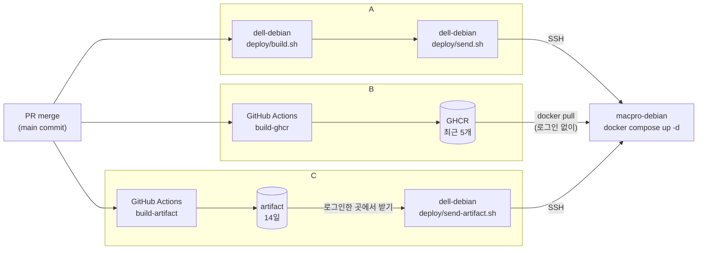

# KEDP 배포 방식 A, B, C

- 근거: KEDP001-D025
- 자세한 명령: `docs/docker-build.md` 12장, `docs/docker-deploy.md` 7장

## 1. 한눈에 보기

| | A | B | C |
| --- | --- | --- | --- |
| image 만드는 곳 | dell-debian | GitHub | GitHub |
| image 두는 곳 | dell-debian | GHCR | artifact |
| 누가 받을 수 있나 | - | **누구나**(로그인 없이) | **어떤 GitHub 계정이든** 로그인만 하면 |
| 보관 | 서버에 남은 image | 최근 5개 | 14일 |

세 방식 모두 같은 소스로 같은 image를 만든다.



## 2. 언제 무엇을 쓰나

| 상황 | 방식 |
| --- | --- |
| 평소처럼 개발 서버에서 바로 | **A** |
| dell-debian을 쉬게 하고, 최근 버전 몇 개 안에서 되돌리고 싶다 | **B** |
| QA까지 확정하고 배포한다. 14일 안에 확정하고, 지나면 되돌리지 않고 고쳐서 새로 만든다 | **C** |

## 3. 세 방식 모두 지키는 규칙

- PR로 main에 merge된 commit만 배포한다.
- tag는 그 commit의 짧은 hash 7자리다. 같은 commit이면 A, B, C의 tag가 같다.
- image 안에 키와 비밀번호는 없다. 키는 macpro-debian의 `.env`에서 넣는다.
- 비용은 0이다(공개 저장소, 공개 package).

## 4. 실제로 하는 일

### A

`docs/docker-deploy.md` 7장 "새 버전 올리기"

### B

1. GitHub: Actions → **build-ghcr** → Run workflow → Summary에서 tag 확인
2. macpro-debian(`/srv/projects/kedp`)

```bash
curl -fsSL https://raw.githubusercontent.com/schware/aidev-KEDP001/main/deploy/compose.yaml -o compose.yaml   # compose.yaml이 바뀌었을 때만
KEDP_IMAGE_PREFIX=ghcr.io/schware/ KEDP_IMAGE_TAG=<tag> docker compose pull go rust nginx
KEDP_IMAGE_PREFIX=ghcr.io/schware/ KEDP_IMAGE_TAG=<tag> docker compose up -d
```

### C

1. GitHub: Actions → **build-artifact** → Run workflow → Summary에서 tag 확인
2. dell-debian(GitHub에 로그인된 곳)

```bash
cd /srv/projects/aidev-kedp001 && git switch main && git pull
deploy/send-artifact.sh macpro-debian <tag>
```

3. macpro-debian(`/srv/projects/kedp`)

```bash
KEDP_IMAGE_TAG=<tag> docker compose up -d
```

## 5. 알아 둘 것

- C의 artifact가 사라져도 이미 macpro-debian에 받아 둔 image는 그대로 있다.
- macpro-debian에서 `gh auth login`으로 로그인하면 C도 macpro-debian에서 바로 받을 수 있다. D025는 실행 서버에 GitHub token을 두지 않으려고 dell-debian에서 받기로 정했다. 바꾸려면 D025 결론 5를 고친다.
- 명령 앞에 `KEDP_IMAGE_TAG=<tag>`를 붙이면 `.env`를 고치지 않고 그 실행에만 쓴다. 값 없이 `docker compose up -d`를 하면 `.env`에 적힌 버전으로 뜬다.
